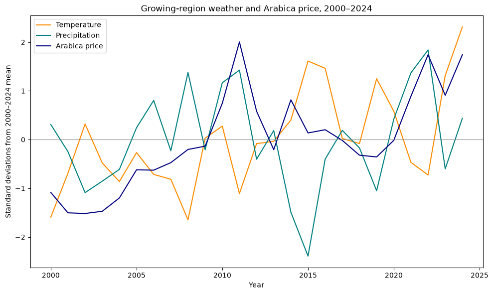
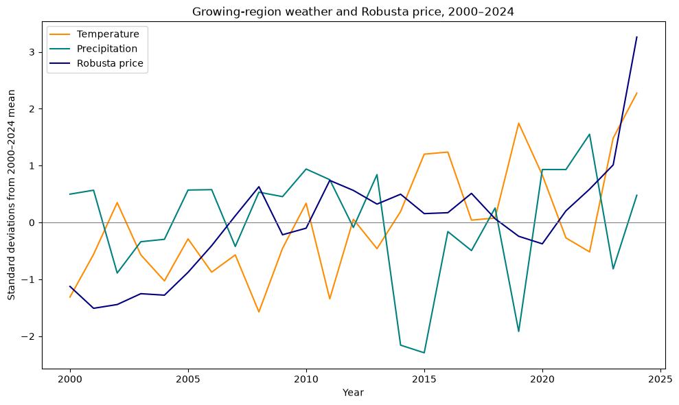
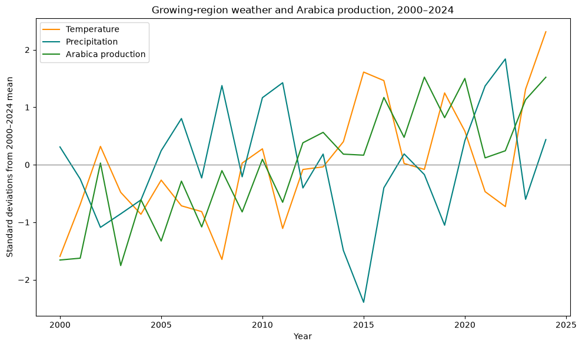
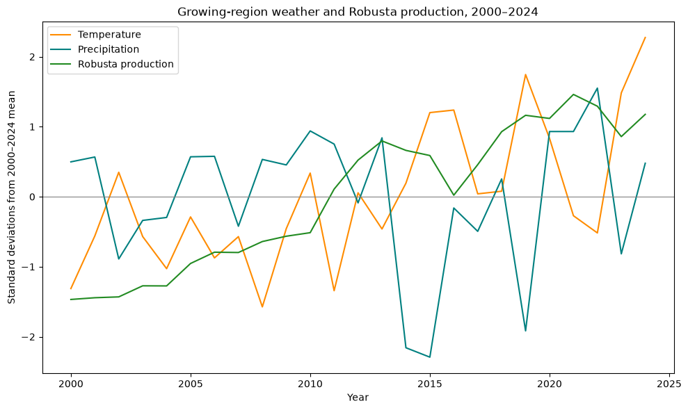

# Is Global Warming Making Your Coffee More Expensive?  
Group Members: Saakshi Philip, Neha Pillai, Anika Chhillar, Alexis Singh, Andrea Findley

## Research Question and Project Overview  
Our project looked at the question: Is global warming making our coffee more expensive? Within our project’s scope, we examined associations between annual temperature, precipitation, coffee production, and global wholesale coffee prices.

## Data Sources and Data Collection  
In order to perform this analysis, we gathered data on the two leading coffee bean types in the world: Robusta and Arabica. Robusta and Arabica beans are primarily produced in Brazil, Colombia, Vietnam, Indonesia, and Ethiopia. As such, we first collected data from [USDA Production, Supply, and Distribution (PSD)](https://apps.fas.usda.gov/psdonline/app/index.html#/app/downloads) on the annual coffee production for each of the five selected countries, separated by Arabica and Robusta coffee bean production. Then, we collected global wholesale coffee prices for [Arabica](https://fred.stlouisfed.org/series/PCOFFOTMUSDM) and [Robusta](https://fred.stlouisfed.org/series/PCOFFROBUSDM) coffee beans from the International Monetary Fund from the Federal Reserve Economic Data site.  

Next, we found climate data from the [World Bank Climate Change Knowledge Portal](https://climateknowledgeportal.worldbank.org/download-data) to account for climate conditions in the five main production countries. Within each country, we only gathered climate data for the regions in which coffee is primarily grown to avoid our data being skewed by weather in regions that don’t facilitate crop production. In Brazil, we collected climate data only from the region of Minas Gerais. For Vietnam, we pulled climate data from the Central Highlands, Dak Lak, Gia Lai, Dak Nong, Lam Dong, and Kontum regions. In Colombia, we looked at the North (Caldas, Quindío, Risaralda) and South (Huila, Cauca, and Nariño) regions. For Indonesia, we accounted for Sumatra. Finally, for Ethiopia, we collected data for the Sidama, Oromia, and SNNP regions. The climate factors we collected data for were precipitation and temperature, to keep the scope of our project manageable. 

## Data Cleaning and Methodology  
After collecting our data, we found that coffee production data was yearly data. As such, we wanted to make all of our data yearly in order to align our data for comparison. The pricing and climate data were monthly, so in cleaning those files, we averaged the monthly data to obtain a singular annual average for each of our variables of interest. As such, our cleaned temperature, precipitation, and pricing files each had an annual average column to facilitate our end analysis, while production had an annual production total quantity column. Additionally, for the climate data, because we collected data on the primary growing regions within the five countries we were investigating, we averaged the regional data by country so we could have one observation per country per year for the main regions that produce coffee beans. We repeated this process for yearly average temperatures per country.  

Once the production, pricing, temperature, and precipitation CSVs were cleaned, we merged the data into one dataset that was indexed by country and year, and included the following columns: Arabica Production, Robusta Production, Total Production, Annual Average Precipitation, Annual Average Temperature, Arabica Cents/Pound, and Robusta Cents/Pound. We were then able to use this dataset for analysis.

## Results and Findings  
In our analysis, we looked at yearly precipitation and yearly temperatures against global wholesale coffee pricing of each type of coffee bean, and yearly precipitation and yearly temperatures against production for each bean. We made multiple plots to see any visual trends, and we used correlations to evaluate the strength and direction of the relationships between the variables. In order to make comparisons across data with different units of measurement, we standardized each variable (temperature, precipitation, pricing, and production) to overlay them on the same graphs and see potential trends across time. It should be noted that we kept the types of coffee beans separated in our analysis, rather than looking at “total pricing” or “total production” to avoid the data being skewed, as Ethiopia and Colombia listed zero production for Robusta coffee across our data timeframe. However, all five countries we researched did have production data for Arabica coffee, so we did not exclude any countries in our Arabica graphs or correlation calculations.  

For our analysis, we first looked at how prices move with both temperature and precipitation across time. For Arabica, we saw that prices had some movement with precipitation and temperature, but less so in temperature. Our correlation table reflected this, with Arabica pricing having a correlation of 0.4 with precipitation and 0.3 with temperature. For Robusta, we noticed that pricing seemed to moderately follow the trend in temperature, but it didn’t appear to be strongly related to changes in precipitation. Again, our correlation table reflects these trends, as Robusta pricing had a correlation of 0.44 with temperature and 0.04 with precipitation. After looking at our main question between pricing and climate, we looked into potential trends between climate and production, since climate may have an effect on production, which is likely to have an effect on coffee pricing. Here, we found that both Arabica and Robusta production followed the movement of growing-region temperature fairly closely across time, with Arabica production having a 0.668 correlation with temperature and Robusta production having a 0.546 correlation with temperature. Precipitation and production, though, did not seem to follow similar trends (correlation for Arabica production was \-0.015 and Robusta was \-0.05). While the upward trend in production following the upward trend in temperature could be reflective of production benefitting from increasing temperatures, there are many other factors that could be contributing to increasing production of these coffee beans over time. As such, while our data revealed some positive correlations between pricing, temperature, precipitation, and production, our analysis cannot establish that climate change is leading to increasing coffee prices.

### Graphs

#### Arabica Weather and Prices


#### Robusta Weather and Prices


#### Arabica Weather and Production


#### Robusta Weather and Production


### Correlation Tables
[Weather and Coffee Price Correlations](artifacts/weather_price_correlations.csv)
[Weather and Production Correlations](artifacts/production_correlations.csv)

## Limitations and Future Extensions  
Our analysis had multiple limitations. First, the data we collected only accounted for the years 2000-2024, providing 25 annual observations per country. This limited our ability to examine longer-term climate trends, but we restricted the period to keep the project manageable. An extension of this project would ideally include as many years as the data would allow (all relevant data is available for a given year).  

Secondly, our pricing data did not account for inflation. The global wholesale prices we collected for each year were listed in nominal US cents per pound. As such, we were unable to distinguish coffee-specific price changes from general inflation price changes. Again, in a future extension, we would ideally account for inflation, as inflation is very likely a factor contributing to higher coffee prices, and it would allow us to compare coffee prices over time after accounting for changes in the general price level.  

Furthermore, in using yearly averages for the climate data, we were unable to see seasonal-specific conditions that likely affect coffee production (as crop production and harvesting occur in specific periods of the year). Additionally, because we only had country-level production data, we were unable to compare the regional climate data to region-level production data (hence our averaging of the regions into one singular country-level average for the climate data). In a future extension, it would be more informative to examine weather during specific growing and harvesting seasons by the regions that primarily produce coffee beans in each country.  

There are many other factors that we were unable to account for in our analysis that likely increase coffee prices, including demand, exchange rates, agricultural production costs, and more. As such, future extensions that permit a larger scope of this project should account for such factors if and when possible.

## Reproducibility

All data cleaning and analysis for this project are performed using Python. The original datasets are included in the repository under “data/raw/”, and no manual modifications to the datasets should be made. All commands should be run from the main project directory.

### Step 1: Clone the Repository  
```bash
git clone https://github.com/saakship19/Git-Happens-Fall-2026-Midterm-Project.git  
cd Git-Happens-Fall-2026-Midterm-Project
```

### Step 2: Install Required Packages  
Ensure Python is installed, then install the required packages: 

```bash
python -m pip install -r requirements.txt
```

### Step 3: Prepare the Output Directories  
```bash
mkdir -p data/clean/temp data/clean/per artifacts
```

### Step 4: Clean the Price and Production Data  
```bash
python code/prices.py  
python code/supply.py
```

The scripts generate cleaned Arabica and Robusta price and production datasets in “data/clean/”.

### Step 5: Clean and Combine the Climate Data  
First, clean temperature data for the five countries and combine the results:

```bash
python code/temp_clean_Brazil.py  
python code/temp_clean_Colombia.py  
python code/temp_clean_Ethiopia.py  
python code/temp_clean_Vietnam.py  
python code/temp_clean__Indonesia.py  
python code/temp_combine.py
```

Next, clean and combine precipitation data:  

```bash
python code/per_clean_all.py  
python code/per_combine.py
```

The resulting files include temperature\_combined.csv and precipitation\_combined.csv in data/clean/.

### Step 6: Merge the Datasets  
```bash
python code/build_dataset.py
```

The script combines the cleaned price, production, temperature, and precipitation data, producing: 
data/clean/coffee_by_country.csv  
data/clean/coffee_by_year.csv  
data/clean/coffee_combined.csv

### Step 7: Reproduce the Analysis  
```bash
python code/analysis.py
```

This script produces 12 graphs and two correlation tables in the artifacts/ directory:  
artifacts/weather\_price\_correlations.csv  
artifacts/production\_correlations.csv  
12 PNG graphs comparing weather, coffee production, and prices.  
Running these scripts in order should reproduce the cleaned datasets and analysis outputs using the included raw data. 

## Repository Structure
```text
Git-Happens-Fall-2026-Midterm-Project/
├── README.md
├── requirements.txt
├── code/
│   ├── prices.py
│   ├── supply.py
│   ├── temp_clean_*.py
│   ├── temp_combine.py
│   ├── per_clean_all.py
│   ├── per_combine.py
│   ├── build_dataset.py
│   └── analysis.py
├── data/
│   ├── raw/
│   └── clean/
└── artifacts/
    ├── *.png
    ├── weather_price_correlations.csv
    └── production_correlations.csv
```

The repository is organized into the following directories and files:
- code/ contains the Python scripts used to clean, combine, and analyze the datasets.
- data/raw/ contains the original coffee production, pricing, and climate datasets.
- data/clean/ contains the cleaned and merged datasets that are produced from the cleaning scripts.
- artifacts/ contains the graphs and correlation tables generated from the analysis script and used for analysis.
- requirements.txt lists the Python packages required to reproduce the project.
- README.md contains the project overview, methodology, findings, limitations, and reproducibility instructions.

## Team contributions:

- Saakshi: Found and cleaned coffee production data  
- Neha: Found and cleaned coffee pricing data  
- Anika: Found and cleaned climate data  
- Alexis: Merged the production, pricing, and climate data into one comprehensive dataset for comparison  
- Andrea: Created graphs and correlation tables for analysis, reviewed and approved pull requests, and wrote the README report
